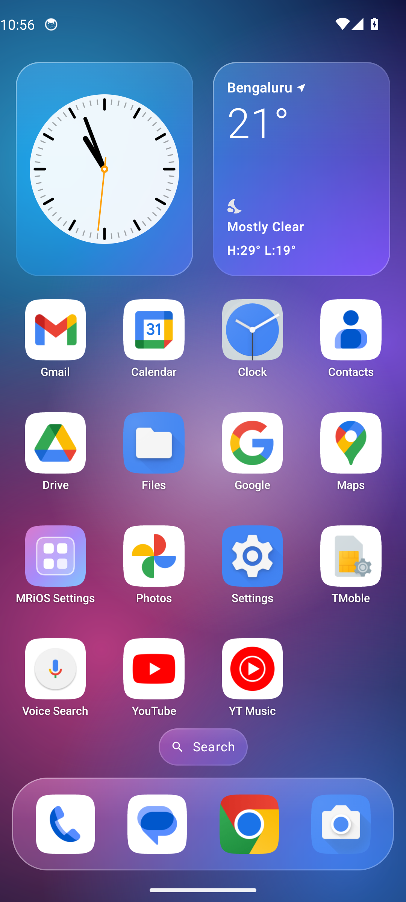
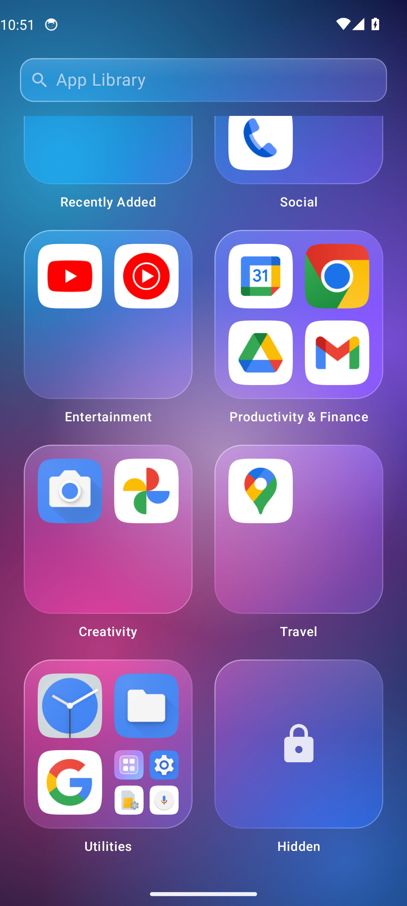
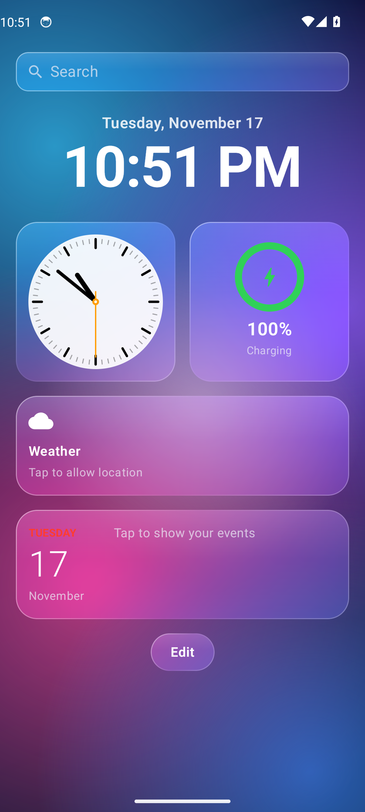
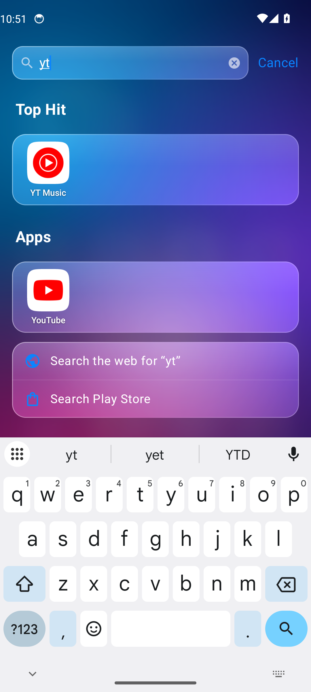
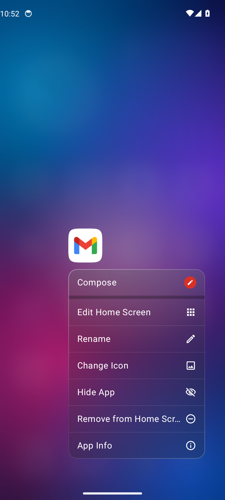
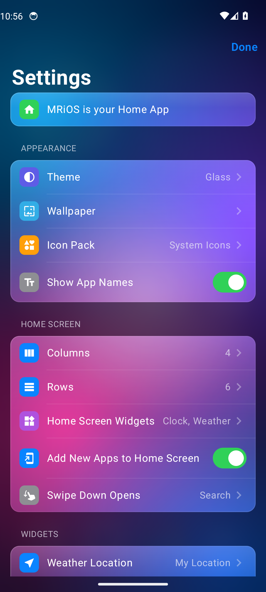
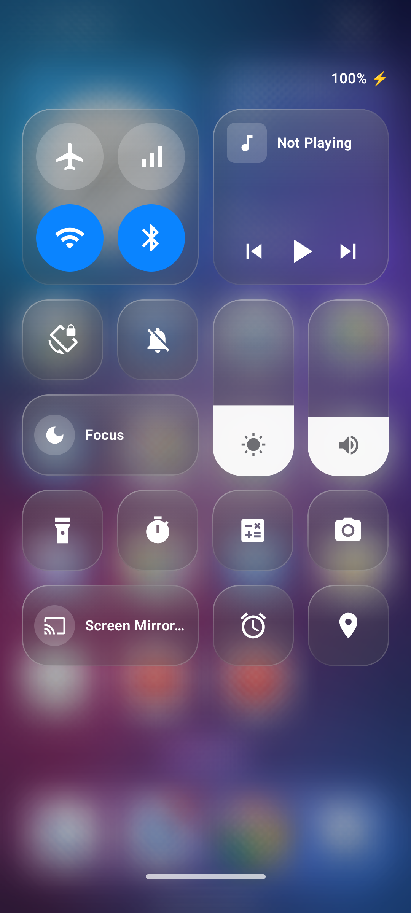
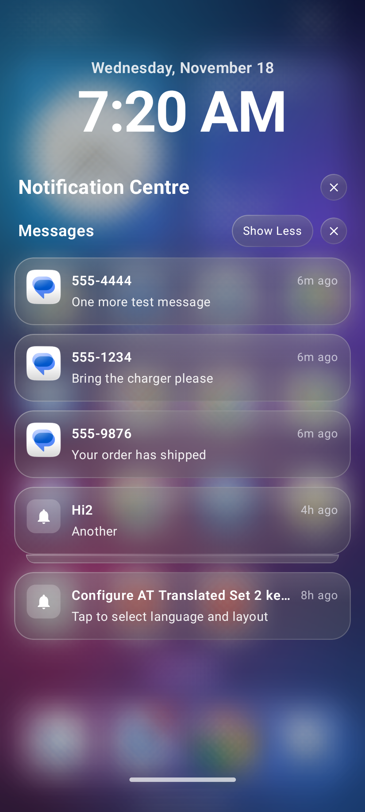
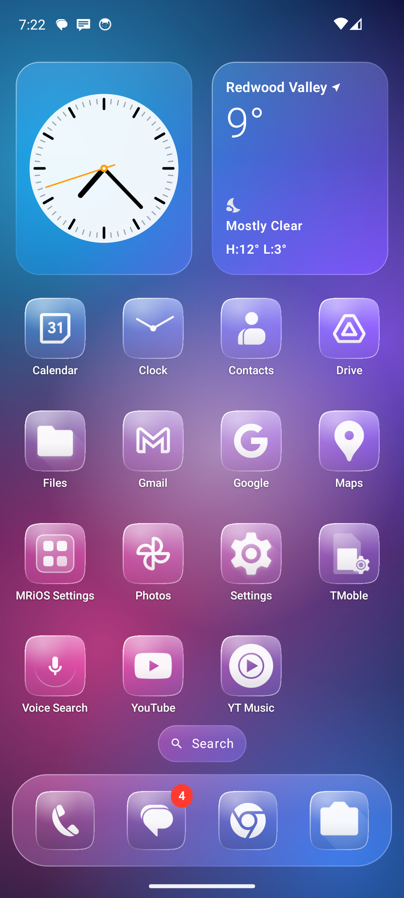

# MRiOS Launcher

**A liquid-glass, iPhone-style home screen for Android 8.0+.** No root needed.

[](https://github.com/dhawan9898/MRiOS-Launcher/actions/workflows/android-ci.yml)
[](https://github.com/dhawan9898/MRiOS-Launcher/releases/latest)

<p>
  
  
  
  
  
  
  
  
  
</p>

## Download

Get **`MRiOS-Launcher-vX.Y.apk`** from the [latest release](https://github.com/dhawan9898/MRiOS-Launcher/releases/latest). Each release also has a `.sha256` checksum file.

1. Open the APK on your phone. Allow "install unknown apps" for your browser or file manager if Android asks.
2. Press **Home** and choose **MRiOS Launcher**, or tap "Set as Home App" on the welcome screen.

## Features

- **Liquid-glass interface:** frosted panels, dock, menus and folders.
- **Glass app icons:** four icon styles. *Glass* adds a specular sheen and rim. *Clear* shows a white glyph on frosted glass. *Tinted* shows a coloured glyph on dark glass. *Original* leaves icons unchanged.
- **Control Centre:** swipe down from the top-right corner, in any app. It has connectivity status, music controls, brightness and volume sliders, rotation lock, silent mode, Focus (Do Not Disturb), torch and shortcuts.
- **Notification Centre:** swipe down from the top-left corner, in any app. Notifications are stacked by app; tap a stack to expand it, swipe left to clear, or tap to open.
- **App Library:** apps sorted into categories automatically, plus Suggestions, Recently Added and an A–Z search.
- **Widgets:** clock, weather, calendar and battery, plus a Today view.
- **Swipe-down search:** fuzzy app search, a calculator, and web or Play Store search.
- **Hidden folder:** locked with fingerprint, face or screen lock, or with a PIN.
- **Personalisation:** rename apps, change icons (photo or icon pack), wallpaper picker, grid size.
- **Two themes:** Glass and Transparent.
- **Languages:** English and Hindi.
- **More:** jiggle edit mode with drag and drop, app shortcuts on long-press, notification badges.

More detail on using and building the app is in [`android/README.md`](android/README.md).

## Development

The app is in [`android/`](android/), built with Kotlin and Jetpack Compose.

```bash
cd android
./gradlew assembleDebug        # → app/build/outputs/apk/debug/app-debug.apk
```

### CI/CD

| Workflow | Runs on | Does |
|---|---|---|
| [Android CI](.github/workflows/android-ci.yml) | every push and pull request that touches `android/` | builds the debug APK, runs lint, and attaches both to the run |
| [Release APK](.github/workflows/android-release.yml) | every push to `main` that changes the app, a pushed `v*` tag, or a manual run | builds a signed release APK and publishes it with a checksum on the [Releases page](https://github.com/dhawan9898/MRiOS-Launcher/releases) |

**Releases are automatic.** Every push to `main` that changes the app (`android/` or the release workflow) publishes the next version: v1.0 → v1.1 → v1.2 … The version name follows the tag, and the version code increases with every run, so phones accept each release as an update.

- To skip a release, put `[skip release]` in the commit message.
- To bump the major version, push a tag (`git tag v2.0 && git push origin v2.0`); automatic releases then continue from v2.1.
- You can also run **Actions → Release APK → Run workflow**. Leave the tag empty for the next version.

**One-time setup:** the release workflow signs with your own key, stored as repository secrets. Phones only accept an update if it's signed with the same key as the installed version, so keep the keystore and password backed up.

| Secret | Value |
|---|---|
| `MRIOS_KEYSTORE_BASE64` | `base64 -w0 your-release.jks` |
| `MRIOS_KEYSTORE_PASSWORD` | keystore password |
| `MRIOS_KEY_ALIAS` | key alias |
| `MRIOS_KEY_PASSWORD` | key password |

To create a keystore:

```bash
keytool -genkeypair -keystore mrios-release.jks -alias mrios -keyalg RSA -keysize 4096 -validity 10000
```

## Credits

Original MRiOS concept and branding by [Rakshittips](https://github.com/Rakshittips). Weather data from [Open-Meteo](https://open-meteo.com).

Not affiliated with or endorsed by Apple Inc. No Apple fonts, icons or artwork are included.
